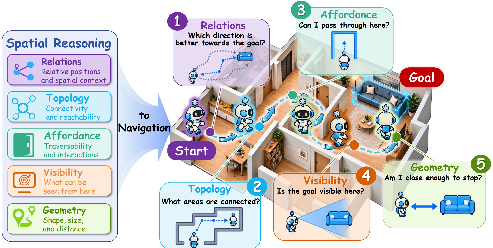

## Beyond Spatial Benchmarks: From Spatial Reasoning to Navigation

<div align="center">

[](https://arxiv.org/abs/2609.29934) [](https://huggingface.co/datasets/hx24/spatial-nav-100k-dataset) [](https://huggingface.co/hx24/spatial-nav-models)

</div>

<div align="center">
  
</div>


Spatial-Nav studies how spatial supervision transfers from vision-language benchmarks to embodied navigation. This release includes the Spatial-Nav-100K training interface, Qwen3-VL-8B training code, and checkpoint evaluation code for Qwen3-VL-8B and InternVL3-8B.

## Quick Start

The training data is released as Spatial-Nav-100K (about 100K spatial instruction examples). Evaluation uses the HM3D-v1, HM3D-v2, and MP3D navigation sets. Scene files, object-navigation annotations, navigation meshes, base-model weights, and training images are downloaded separately because of their size or license.

The commands below assume a Linux x86-64 machine with eight visible GPUs.

### 1. Prepare data and models

Choose writable storage and download the released dataset and checkpoint metadata:

```bash
export NAV_CACHE=/path/to/spatial-nav-cache
export NAV_RESULTS=/path/to/spatial-nav-results
export SPATIAL_NAV_DATA_ROOT="$NAV_CACHE/datasets"
export SPATIAL_NAV_MODEL_ROOT="$NAV_CACHE/models"
export SPATIAL_NAV_CHECKPOINT_ROOT="$NAV_CACHE/checkpoints"
export SPATIAL_NAV_DATASET_ID=hx24/spatial-nav-100k-dataset
export SPATIAL_NAV_CHECKPOINT_REPO=hx24/spatial-nav-models

bash tools/download_hf_assets.sh
```

For evaluation, also place the licensed HM3D-v1, HM3D-v2, or MP3D scene/objectnav assets at local paths. MP3D additionally needs its validation navigation meshes.

### 2. Create the environments

The helper creates separate environments for training, simulator workers, and model serving:

```bash
tools/bootstrap_envs.sh --prefix "$NAV_CACHE/envs"
export TRAIN_PY="$NAV_CACHE/envs/train/bin/python"
export SIM_PY="$NAV_CACHE/envs/sim/bin/python"
export SERVE_PY="$NAV_CACHE/envs/serve/bin/python"

"$TRAIN_PY" codes/scripts/train.py \
  --data "$SPATIAL_NAV_DATA_ROOT" --verify-only
```

The package lists are in `requirements-*.txt`; the environment files contain the simulator and serving setup.

### 3. Train Qwen3-VL-8B

Run the complete training chain on GPUs 0–7:

```bash
"$TRAIN_PY" codes/scripts/train.py \
  --architecture qwen3-vl-8b \
  --base-model "$NAV_CACHE/models/Qwen3-VL-8B-Instruct" \
  --data "$SPATIAL_NAV_DATA_ROOT" \
  --output "$NAV_RESULTS/runs/qwen3-vl-8b" \
  --stage all --gpus 8 --gpu-ids 0,1,2,3,4,5,6,7
```

The command runs the Foundation, Move, and Stop stages and writes the adapters and merged checkpoints below `NAV_RESULTS`.

### 4. Evaluate a checkpoint

Set `DATASET` to `hm3d_v1`, `hm3d_v2`, or `mp3d`. The standard layout uses four Move servers on GPUs 0–3, four Stop servers on GPUs 4–7, and ten workers per GPU:

```bash
export DATASET=hm3d_v2
export SCENE_ROOT=/path/to/scene-root
export OBJECTNAV_ROOT=/path/to/objectnav-root
export RUN_DIR="$NAV_RESULTS/eval/qwen3-vl-8b/$DATASET"

"$TRAIN_PY" codes/scripts/evaluate.py \
  --architecture qwen3-vl-8b --variant checkpoint \
  --base-model "$NAV_CACHE/models/Qwen3-VL-8B-Instruct" \
  --dataset "$DATASET" \
  --scene-root "$SCENE_ROOT" --objectnav-root "$OBJECTNAV_ROOT" \
  --checkpoint-root "$SPATIAL_NAV_CHECKPOINT_ROOT/qwen3-vl-8b" \
  --run-dir "$RUN_DIR" \
  --worker-python "$SIM_PY" --serve-python "$SERVE_PY" \
  --move-gpus 0,1,2,3 --stop-gpus 4,5,6,7 \
  --sim-gpus 0,1,2,3,4,5,6,7 --workers-per-gpu 10 \
  --allow-shared-server-gpus --gpu-memory-utilization 0.70 \
  --request-routing historical --max-steps 500 --image-res 1920 \
  --max-num-seqs 64 --move-max-model-len 3072 --stop-max-model-len 4096 \
  --worker-gpu-device-id 0 --stop-threshold 2.0
```

For a newly trained Qwen3 model, pass its `compose/final_adapter` and `stop_merged` directories with `--move-checkpoint` and `--stop-checkpoint`. For InternVL3, change the architecture and base model and use `--stop-threshold 0.0`. Each run writes `metrics.json` and `run_config.json` to `RUN_DIR`.

## Recorded results

The table includes both evaluation settings. `Pretrained checkpoint` means the released model was loaded directly for evaluation. `Retrained checkpoint` means the Qwen3-VL-8B model was trained with the commands above and then evaluated.

Results are percentages reported as `SR / SPL`:

| evaluation setting | checkpoint | HM3D-v1 | HM3D-v2 | MP3D |
|---|---|---:|---:|---:|
| Retrained checkpoint (8-GPU full training) | Qwen3-VL-8B | 60.25 / 30.47 | 76.80 / 34.86 | 48.43 / 20.47 |
| Pretrained checkpoint (loaded directly) | InternVL3-8B | 57.80 / 31.22 | 72.40 / 34.66 | 42.23 / 19.53 |

## Repository layout

- `codes/`: training, model serving, evaluation, and simulator preparation.
- `environment/`: environment definitions for training, serving, and workers.
- `tools/`: dataset/checkpoint download and MP3D preparation helpers.
- `reproduction/`: recorded commands, logs, metrics, and timing notes.
- `checkpoint_configs/`, `checkpoints/`: public checkpoint configuration and tokenizer files; large weights remain on Hugging Face.
- `tests/`: lightweight integrity and command checks.

## Citation

```bibtex
@article{huang2026spatialnav,
  title   = {Beyond Spatial Benchmarks: From Spatial Reasoning to Navigation},
  author  = {Huang, Xun and Zhao, Shijia and Qu, Rongsheng and Li, Jiayuan and Lu, Xin and Li, Weixin and Wen, Chenglu and Wang, Cheng},
  journal = {arXiv preprint arXiv:2609.29934},
  year    = {2026}
}
```

See [README_CN.md](README_CN.md) for a concise Chinese entry point. For detailed phase settings, observed training/evaluation time, output files, and reproduction results, see [REPRODUCTION.md](REPRODUCTION.md).
